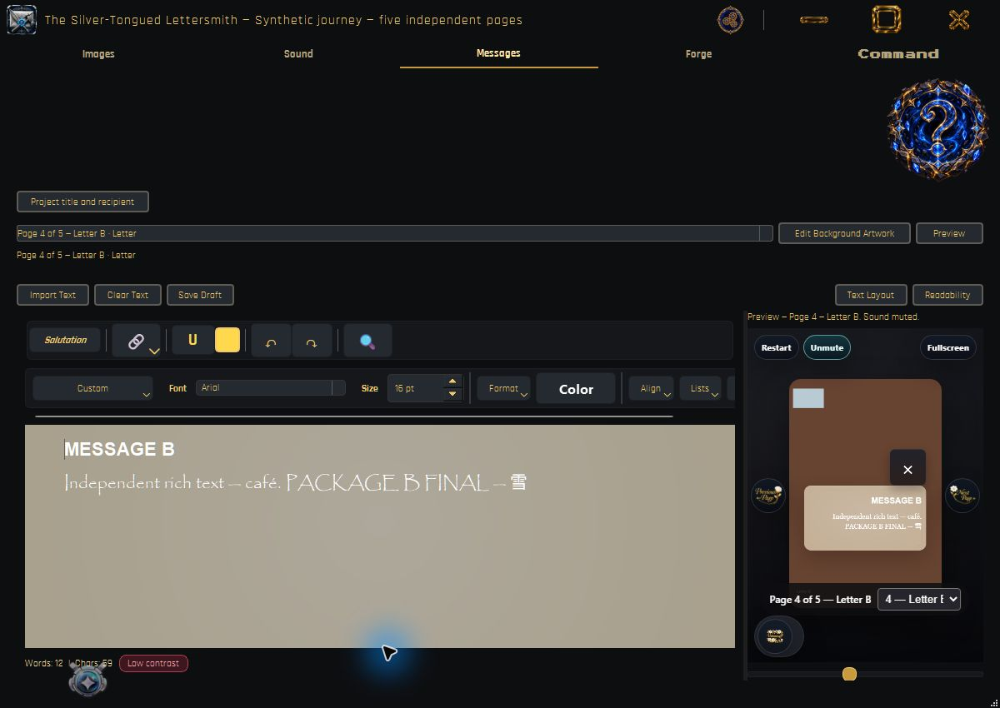
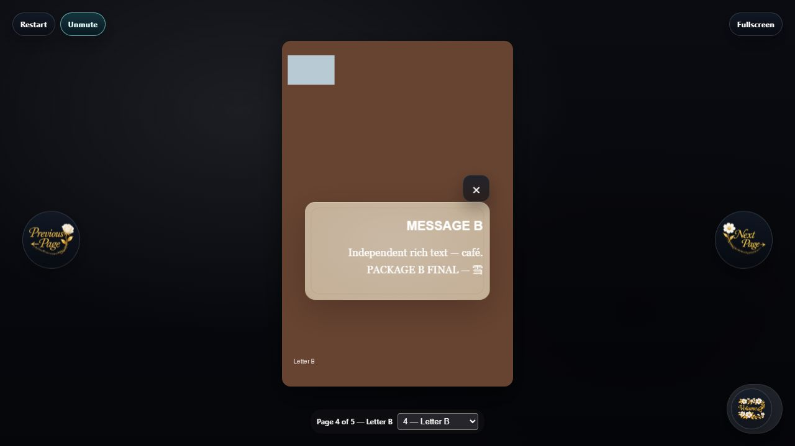

# Letter Smith final integration and delivery verification

Candidate source: `20d0be7abc48eac95c1fbc00e4b6161b8b5baeda`.
The final suite ledger below is generated only from a completed, successful run
of every discovered module. Later evidence commits contain documentation only.

The redesign is implemented on the combined application. Verification covers the
recorded production service/widget/renderer tests, Windows native checks and
packaged/browser smoke checks. This is not a signed, clean-machine or macOS
release approval. No live presentation was published.

Related deliverables:

- [Requirement matrix](final-integration-requirements-2026-10-17.md)
- [Defect reproductions and repairs](final-integration-repairs-2026-10-17.md)
- [Build and artifact manifest](final-integration-build-manifest-2026-10-17.json)
- [Exact final test results](final-integration-evidence-2026-10-17/final-results.json)
- [Logs](final-integration-evidence-2026-10-17/verification-logs.zip)
- [Earlier diagnostic results](final-integration-evidence-2026-10-17/earlier-diagnostic-results.zip)
- [Modified paths](final-integration-evidence-2026-10-17/changed-files.txt)
- [Integrated commit history](final-integration-evidence-2026-10-17/integrated-history.txt)

## Baseline and integration record

The task began on clean `codex/ui-synchronization` at
`637da7f86475b243314579bf3242aa1ef8d12690`, in the existing isolated worktree
`C:\Users\Oluwatola Ayedun\.codex\worktrees\saved-letters-complete-projects\SmithLetter`.
Work continued on `codex/final-integration`. All required owner implementations
were present in that ancestry; no speculative sibling branch was merged.

| Owner | Completed commits already integrated |
|---|---|
| Foundation | `1612235`, shared contracts `5156560` |
| Images | `0a73a0e`, integrated routing `c5cfd7d` |
| Messages | `b87bc00`, shared preview `ea6c1f0` |
| Prompt Writer | `f9739b9`, integrated in `c5cfd7d` |
| Sound | `7a8386f`, merged by `9e304a7` |
| Forge | `7c9d698`, merged by `4dc6584` |
| Combined features | `53ec7cf` |
| Saved Letters | `32ce089`, handoff `83fb721` |
| Command & Settings | `7835055`, handoff `f2a0a33` |
| UI & Synchronization | `ed5b725`, handoff `637da7f` |

The Foundation contract/migration guide and each owner's handoff were checked
against imports, canonical operations and production test paths. `Main.py` and
`Nexus.py` remain the entry/shell paths. No schema, serializer, renderer, palette
database or credential store was duplicated. Configured new-project bounds
remain 2–10; unusual imported counts remain editable and preserved.

The separate primary checkout remained on `main` at `1612235` with 13 pre-existing
tracked changes and its untracked work. Those files were not staged or edited.
Their initial and final SHA-256 values were compared; all 13 matched. The candidate
worktree's `settings.json` displayed a Git stat/line-ending flag but had no diff:
its normalized blob remained `05fe2919b52bc236d73f174ad74c1dee934cc080`.

Only the completed integrated ancestry and this task's focused repairs/evidence
are eligible for the separately authorized GitHub update. No force push, history
rewrite, unrelated working-tree capture, live hosting change or account change
is part of this delivery. The [GitHub delivery receipt](final-integration-github-delivery-2026-10-17.md)
records the verified fast-forward source/evidence push.

## Environment and isolation

Windows 11 AMD64 build 26300; Python 3.13.13, PySide6 6.11.1, Pillow 12.3.0,
PyInstaller 6.22.3. The repository supports Windows and macOS; the macOS manifest
requires 15.0 or newer and its configured architecture builds. Only Windows was
available for execution.

Python executable used:
`C:\Users\Oluwatola Ayedun\Desktop\SmithLetter\.venv\Scripts\python.exe`.
It was reused without upgrading dependencies. The missing PyInstaller Windows
bootloader was supplied by the same 6.22.3 wheel in an isolated `build-deps`
directory. Pinned local FFmpeg/FFprobe hashes were checked before copying them;
the existing local Git LFS object supplied `com.gif`.

All runtime writes used explicit `LETTER_SMITH_PROFILE_ROOT` directories under
`C:\Temp\ls10`, with TEMP/TMP there. The test runner also redirects QSettings,
denies Python writes outside its evidence root and blocks non-loopback Python
connections. Chromium DNS is restricted to localhost. Native/package checks
canceled GitHub sign-in and used synthetic messages/resources. Local browser
servers bound only `127.0.0.1` and were closed afterward. No real saved letters,
Music Archive, credentials or reusable user libraries were used.

## Architecture and lifecycle verified

`ProjectSession` and canonical model/repository services own content, permanent
page identity, session generation, revision checks and resource ownership.
Messages owns independent rich documents. Prompt Writer binds the selected page
without rebuilding exact historical/manual strings. Images owns artwork/type
operations. Sound owns the project playlist and audition. Forge owns composition
and public display resources; Messages' preview consumes that same path.

Save commits registered pending editors, including the detached writer, captures
one revision and uses the canonical transactional repository. Completion belongs
to that revision/session; later edits remain dirty. Open/New/Exit share the
existing Save/Discard/Cancel coordinator. Candidate validation precedes activation;
old session callbacks lose authority after committed replacement. Stable IDs
survive selection, renaming, reordering and repeated names/types.

Independent project copies get a new project identity and detach writable
publication targets. Project-scoped page IDs and internal references remain
coherent. Editable snapshots retain inactive/unassigned recovery content, exact
prompts and required resources. Display export includes only active presentation
content and required resources. Source assets and reusable libraries are retained
by reset/delete workflows. Draft readiness is separate from final output readiness.

The Foundation contract now explicitly covers theme ownership/disposal, early
profile resolution, captured artwork imports, read-only writer binding and bounded
managed-directory lock retries. The existing UI Synchronization handoff remains
the route/event inventory; this task repaired consumers rather than adding routes.

## Baseline failures and repairs

The initial single-process discovery found 1,032 cases and stalled in global Qt
theme handling; it did not finish and is not reported as a successful baseline.
The first module-isolated diagnostic run completed 55 modules with 981 completed
cases and 19 failing modules, including native aborts, obsolete expectations and
early verification-guard errors. It started from `637da7f` with working repairs;
it is not an immutable clean-baseline result.

Subsequent diagnostic runs are retained separately and are not added together:

- `c13539b`: 54 modules passed; window-sizing exceeded its 900-second limit.
- `8e42e4a`: captured-artwork ownership regression and a Windows folder-lock
  failure in the seven-curtain round trip. Source changed during that run.
- `9ff030f`: all 55 modules finished successfully, but later source changes during
  the run mean it is not the final immutable candidate.
- `30b00ae`: one intermediate Forge geometry assertion after a fixed 100 ms wait;
  the isolated test and complete layout module passed unchanged on rerun.
- `87f598c`: the layout synchronization repair passed its 20-test module; the full
  run was retired when the managed bundle lock repair changed the candidate.

The repair record documents FIX-01 through FIX-14, including reproductions and
regressions. Production fixes address preview release, theme/callback ownership,
Qt object lifetime, Sound GUI-thread completion/join, profile isolation, correct
page-specific help, false dirty state, captured import identity and transient
managed-directory locks. Obsolete four-slot/private-display test expectations were
corrected against the approved requirements, not weakened to conceal failures.
The resize assertion still requires the original geometry; it now waits for the
real queued layout condition with a bounded deadline.

The final run below follows the last production repair. Persistent lock/failure
tests still assert failure and preservation; no success flag is forced. No known
critical/high-impact in-scope data-loss, wrong-target, privacy, save/load or render
defect remains from the reproduced cases. Unavailable checks are listed separately.

## Five-page acceptance journey

Fixtures are synthetic, not claimed historical user archives. The core fixture
uses Cover, Letter A, Illustration, Letter B, End Page; distinct colored artwork,
independent rich messages/layouts, exact private prompt markers with Unicode and
whitespace, a genuine three-frame GIF and repeated silent playlist occurrences.
Classic/variable legacy, minimum/no-Letter, maximum/excess, middle-End, recovery,
missing/unsafe/future-schema fixtures are exercised in their owning test modules.

| Step | Performed evidence and scope |
|---|---|
| 1. Custom five-page creation | Real Command factory/controller tests; native `9ff030f` custom dialog configured all five types, created and entered the empty editor. |
| 2. Distinct artwork and GIF | Canonical fixture plus real Images import/crop/target tests; source hashes and multiframe decoding checked. Native import-dialog clicking of every fixture image was not repeated. |
| 3. Independent rich messages/layouts | Real Messages widget tests; native packaged edit appended `PACKAGE B FINAL — 雪` only to B; A unchanged on repository comparison. |
| 4. Writer targets/models/directions/build/manual edit | Real launcher and four-model tests. Native B manual prompt appended Unicode, newline and two spaces; final package restored exact text. |
| 5. Private-message exclusion / End wording | Fresh prompt composition assertions and public-output sentinel inspection; no image generation. |
| 6. Custom palette typing/add/select | Production Prompt Writer widget test, including reusable library retention. Not separately clicked in packaged GUI. |
| 7. Rapid switching / last edits | Messages and combined shell widget tests; native Images→Messages and Images→detached Writer on B. |
| 8. Reorder/rename/duplicate/edit copy | Real Images/model/shell tests compare permanent IDs and independent mutable state. |
| 9. Retype away/back and inactive preservation | Real model, Messages, Saved Letters and Forge export tests. Inactive text excluded from public output. |
| 10. Compose each page / GIF / soundtrack ownership | Real WebEngine viewer and shared-preview tests; native Messages B matches browser B; portable frame source changed 00000→00002. Backend audio assertions ran; no audible listening. |
| 11. Immediate save / restart / restore | Real detached pending-edit save/open test; native Ctrl+S and later packaged Open. Exact prompts, IDs and all fixture source hashes compared. |
| 12. Portable display output | Actual Forge ZIP, unpacked outside checkout, loopback browser viewed A/B/GIF and page navigation. Single-HTML portability and modes covered by WebEngine tests. |
| 13. Independent editable copy | Real save/copy service tests verify independent destination/state and detached publication authority. |
| 14. New/Exit Save/Discard/Cancel | Production lifecycle tests for every decision/failure/revision race. Native Cancel Exit and Cancel New preserved pending name; Discard/New retained the explicit save. |
| 15. A→B→A and delayed jobs | Controlled event/barrier tests reject first-session operations, stale saves/imports/renders/batches and old completion notices. |

The native edit origin is `5da1975`; later packages deliberately reopened that
same saved synthetic project. `9ff030f` verified Cancel/New decisions, and
`30b00ae` verified restoration and the corrected writer binding. The latest package
at `20d0be7` restored all five pages, built its embedded Forge preview, exported a
ZIP through the native Export menu/file chooser and shut down cleanly. That ZIP
was opened separately in the local browser. All 40 files match the service export
semantically, with every manifest hash verified; the fresh CSP nonce and its
derived HTML hash are the only legitimate byte differences. The smoke is recorded
in the manifest and `packaged-export-check-20d0be7.json`. Cross-version checks are not
presented as an entire manual journey on one final executable.

The recorded explicit save stayed at generation `7aa7a4193ddb4525` after native
New/Discard/restart/Open. [Preservation evidence](final-integration-evidence-2026-10-17/final-preservation.json)
checks all page IDs/types/names, exact prompts including trailing whitespace,
independent messages and source byte hashes.

## Graphical, media and privacy observations

Native screenshots were captured at a practical 1200×850 application size;
the detached writer was captured separately. The collection distinguishes Example,
Saved draft and Selected, and exposes one Open Project action. Images and Messages
show the actual page number/name/type. B's layout is lower/right aligned, A's
upper/left aligned. Browser inspection used 1280×720. Existing automated layout
checks exercise more sizes/themes; this is not verification of every scaling mode.






Actual QMediaPlayer transport/crossfade/repeat and owned import completion were
tested, in addition to decoded GIF order/settings/source bytes. The native
Windows destruction and maximize/restore tests passed separately. Multi-screen
placement skipped because multiple connected screens were unavailable.

Archive/path containment, unsupported schemas, rich-text sanitization, embedded
resources, synthetic private sentinels, output allowlists and diagnostic privacy
were checked. Display output contains no private prompt marker or editable
repository. This focused regression pass is not a comprehensive security audit.
Provider tests use fake/local transport with real payloads; no user token or live
hosting endpoint was used. Local save failure preserves the known publication
record, and old-output success does not mark a newer revision published.

Measured bounded behavior includes ten canonical selection events for ten page
selections, stable subscriber counts across repeated window use, no Forge rebuild
for private prompt-only edits, and zero whole-window restyles for nonvisual worker
and timer children. No invented throughput, memory-leak guarantee or completion
percentage is claimed. Long-duration memory profiling was not performed.

## Exact verification/build commands

Commands ran from the candidate worktree with the Python executable stated above:

```powershell
python release/verify_tests.py --output C:/Temp/ls10/verified-20d0
python release/verify_tests.py --output C:/Temp/ls10/bundle-lock-fixed --module test_persistence_hardening --module test_curtain_cache --module test_saved_projects
python release/build_release.py --build --confirm-package
python release/build_installer.py --build --confirm-package
python release/build_macos.py --configuration-only
```

Native supplements use `QT_QPA_PLATFORM=windows`, separate explicit profiles and
the same worker isolation guard:

```powershell
python release/verify_tests.py --worker test_window_sizing.WindowSizingTests.test_closing_editor_does_not_create_native_main_content --output C:/Temp/ls10/native-87f5/test_closing_editor_does_not_create_native_main_content.json
python release/verify_tests.py --worker test_window_sizing.WindowSizingTests.test_maximized_launch_button_restores_windows_state_and_bounds --output C:/Temp/ls10/native-87f5/test_maximized_launch_button_restores_windows_state_and_bounds.json
python release/verify_tests.py --worker test_window_sizing.WindowSizingTests.test_native_tool_placement_across_connected_screens --output C:/Temp/ls10/native-87f5/test_native_tool_placement_across_connected_screens.json
```

The third native invocation skipped; it is not a pass. The final candidate differs
from those native supplements only in managed display-directory moves/lock retry
and their regression, not in window geometry/destruction implementation.

Builds used the existing release pipeline and its resource/privacy gates. The
manifest records exact source, artifacts, sizes and SHA-256 values. The installer
was produced but not installed. Windows signing, macOS execution/signing/notarization
and clean-machine release verification were not performed. Older build directories
are diagnostic artifacts and are not the delivered candidate.

All 3,578 files in the pristine build, launched copy and delivered copy were
compared by SHA-256 after shutdown and match. The 99 bundled Example Letter files
also match the source master. An earlier non-Force Windows enumeration omitted
the tracked hidden image manifest; this was a counting issue, not a runtime write.
See [package integrity](final-integration-evidence-2026-10-17/package-integrity-check.json).

## User change notes and short local acceptance path

Cover is the opening illustration; Illustration is artwork only; Letter has its
own illustration and separate Messages document; End Page is closing artwork.
The fresh ending prompt requests “The End”; the renderer adds no duplicate ending
overlay. Repeated types/names and arbitrary order are supported. Historical prompt
strings keep their original words until an explicit rebuild.

Images manages page organization and routes to that page's Messages/Prompt Writer.
Messages keeps each Letter independent. Saved Letters preserves complete editable
projects and recovery data; Forge exports presentation-only content. Copies cannot
overwrite the original publication target. Old supported projects load through
version-aware migration without upgrading their originals merely by browsing.

For a reproducible local check, use a fresh isolated profile, create a custom
Cover→Letter→Illustration→Letter→End Page project, give the two letters different
text/backgrounds, then type a final Writer marker and save immediately. Reopen
through Saved Letters, reorder B before A and confirm its message/prompt follow
the same page. Preview/export locally, then exercise New Project Cancel and
Discard; reopen the saved version. The synthetic fixture helper provides the
deterministic images/GIF/initial state used here, and refuses an existing profile.

Do not point verification at a personal runtime directory. The delivered package
can be launched with an explicit new `LETTER_SMITH_PROFILE_ROOT` and TEMP/TMP
under that profile. The first-run appearance flow still needs manual native
acceptance; the recorded smoke profile already had a synthetic appearance choice.

## Remaining release gates and limits

- macOS 15+ native builds/runs on the supported architectures, signing and
  notarization: unavailable on this Windows host; configuration only was checked.
- Windows Authenticode and installer install/upgrade/uninstall on a clean machine:
  not performed. The delivered local executable/installer is unsigned.
- Multiple-monitor placement, comprehensive display scaling and the optional
  first-run appearance popup: not verified. Two other native window checks passed.
- Audible listening across audio devices and a complete manually repeated
  15-step journey on the final package: not performed. Their stated automated and
  partial native/browser evidence must not be promoted to those claims.

These are concrete verification/release limits, not hidden completed checks. Live
publication was not performed and is not required for this local redesign scope.

## Final suite ledger

Source `20d0be7abc48eac95c1fbc00e4b6161b8b5baeda`. 1041 cases ran in 55 modules; 1038 passed, 3 skipped, zero failures/errors. Sum of module durations: 1078.0 seconds (not a performance target).

| Module | Cases | Skipped | Result |
|---|---:|---:|---|
| test_application_paths | 25 | 0 | Passed |
| test_beta_diagnostics | 6 | 0 | Passed |
| test_command_bar | 26 | 0 | Passed |
| test_command_hold_interaction | 7 | 0 | Passed |
| test_command_immersive_layout | 20 | 0 | Passed |
| test_command_interaction | 18 | 0 | Passed |
| test_command_settings | 16 | 0 | Passed |
| test_curtain_cache | 11 | 0 | Passed |
| test_developer_mode | 3 | 0 | Passed |
| test_ffmpeg_provisioning | 4 | 0 | Passed |
| test_forge_render | 25 | 0 | Passed |
| test_forge_session_output | 13 | 0 | Passed |
| test_foundation_consumers | 17 | 0 | Passed |
| test_github_publishing | 66 | 0 | Passed |
| test_identity_field_locking | 31 | 0 | Passed |
| test_image_animation | 48 | 0 | Passed |
| test_images_workspace | 23 | 0 | Passed |
| test_language_service | 10 | 0 | Passed |
| test_message_overlay | 13 | 0 | Passed |
| test_message_security | 25 | 0 | Passed |
| test_message_shared_preview | 7 | 0 | Passed |
| test_messages_workspace | 25 | 0 | Passed |
| test_named_text_style_document | 5 | 0 | Passed |
| test_named_text_style_editor | 25 | 0 | Passed |
| test_named_text_style_preview | 3 | 0 | Passed |
| test_named_text_styles | 9 | 0 | Passed |
| test_page_layout | 8 | 0 | Passed |
| test_page_viewer | 10 | 0 | Passed |
| test_persistence_hardening | 14 | 0 | Passed |
| test_project_model | 33 | 0 | Passed |
| test_project_repository | 15 | 0 | Passed |
| test_project_session | 31 | 0 | Passed |
| test_prompt_writer_hardening | 38 | 0 | Passed |
| test_prompt_writer_legacy_removal | 2 | 0 | Passed |
| test_prompt_writer_pages | 13 | 0 | Passed |
| test_readiness_editor_paths | 59 | 0 | Passed |
| test_save_schema_migration | 6 | 0 | Passed |
| test_saved_letter_activity_order | 23 | 0 | Passed |
| test_saved_letter_loading_overlay | 3 | 0 | Passed |
| test_saved_letter_recipient_restore | 1 | 0 | Passed |
| test_saved_letter_restore_sound | 32 | 0 | Passed |
| test_saved_projects | 18 | 0 | Passed |
| test_small_improvement_smoke | 25 | 0 | Passed |
| test_sound_archive_preview | 24 | 0 | Passed |
| test_sound_playback_lifecycle | 14 | 0 | Passed |
| test_sound_project_playback | 24 | 0 | Passed |
| test_sound_restore_lock | 10 | 0 | Passed |
| test_sound_visualizer_fallback | 12 | 0 | Passed |
| test_support_information | 14 | 0 | Passed |
| test_tab_hover_switch | 6 | 0 | Passed |
| test_themed_button_states | 28 | 0 | Passed |
| test_ui_synchronization | 7 | 0 | Passed |
| test_ui_theme | 53 | 0 | Passed |
| test_viewer_start | 1 | 0 | Passed |
| test_window_sizing | 36 | 3 | Passed |

Skipped offscreen cases:

- `test_window_sizing.WindowSizingTests.test_closing_editor_does_not_create_native_main_content` — Requires native Windows window destruction.
- `test_window_sizing.WindowSizingTests.test_maximized_launch_button_restores_windows_state_and_bounds` — Requires QT_QPA_PLATFORM=windows; offscreen cannot reproduce this bug.
- `test_window_sizing.WindowSizingTests.test_native_tool_placement_across_connected_screens` — Requires the native Windows platform and multiple screens.

The first two skipped cases passed separately on native Windows. The multi-screen case also skipped on native Windows because multiple screens were unavailable. No duplicated runs are added to the suite count.
